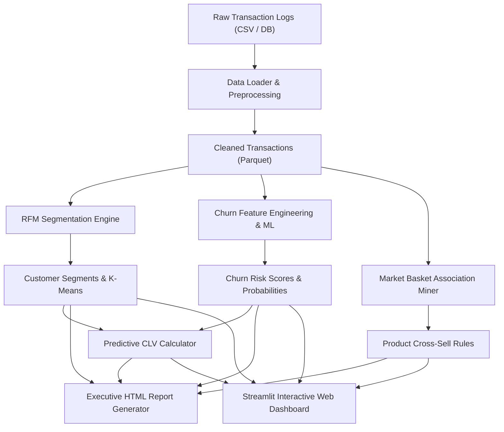

# Customer Intelligence & E-Commerce Analytics Platform 🛒📊

[](https://github.com/satyam0404/customer-intelligence-platform/actions)
[](https://www.python.org/)
[](https://opensource.org/licenses/MIT)
[](https://github.com/psf/black)

A production-grade, end-to-end customer analytics suite engineered to turn raw e-commerce transaction logs into high-impact business insights, predictive churn prevention, customer lifetime value projections, and automated executive reporting.

---

## 🌟 Key Capabilities

- **🎯 RFM Customer Segmentation**:
  - Statistical quintile scoring across Recency, Frequency, and Monetary dimensions.
  - Multi-tier segmentation (Champions, Loyal Customers, At Risk, Can't Lose Them, etc.).
  - Unsupervised K-Means clustering benchmarking with log-transformed, standard-scaled feature spaces.

- **🔮 Supervised ML Churn Modeling**:
  - Behavioral feature engineering capturing purchase intervals, return rates, and spend consistency.
  - Multi-model evaluation comparing **Random Forest**, **Gradient Boosting**, and **Logistic Regression**.
  - Risk tier stratification (Low, Medium, High Risk) with actionable priority retention lists.

- **🛍️ Market Basket Analysis & Product Affinity**:
  - Association rule mining extracting **Support**, **Confidence**, **Lift**, and **Conviction**.
  - Cross-sell recommendation engine to optimize checkout bundle promotions and increase Average Order Value (AOV).

- **💎 Discounted Customer Lifetime Value (CLV)**:
  - Multi-period discounted cash-flow projection integrating retention survival curves and margins.
  - Customer tier stratification into Platinum, Gold, Silver, and Bronze accounts.

- **🖥️ Interactive Streamlit Dashboard**:
  - Real-time filtering by country, device, and payment method.
  - 3D interactive RFM scatter visualization and treemaps.
  - What-If Churn Simulator with dynamic probability scoring.
  - Interactive product bundling and co-purchase search.

- **📑 Automated Executive Summary Report**:
  - Self-contained, responsive HTML executive report with key KPIs, tables, and strategic playbooks.

---

## 🏗️ Architecture



---

## 📂 Repository Structure

```text
customer-intelligence-platform/
├── .github/
│   └── workflows/
│       └── ci.yml               # Automated multi-version CI testing workflow
├── app/
│   ├── __init__.py
│   └── dashboard.py             # Streamlit 5-tab interactive analytics app
├── data/
│   ├── raw/                     # Raw transaction datasets
│   └── processed/               # Cleaned parquet & processed CSV outputs
├── notebooks/
│   └── customer_intelligence_deep_dive.ipynb # End-to-end Jupyter analysis
├── reports/
│   └── executive_summary.html   # Standalone compiled executive report
├── src/
│   ├── __init__.py
│   └── pipeline.py              # Consolidated main pipeline logic
├── tests/
│   ├── __init__.py
│   └── test_pipeline.py         # Consolidated test suite
├── .gitignore
├── LICENSE
├── pyproject.toml
├── requirements.txt
└── README.md
```

---

## 🚀 Quickstart Guide

### 1. Prerequisites
- Python 3.10, 3.11, or 3.12
- Git

### 2. Installation
Clone the repository and install dependencies:

```bash
git clone https://github.com/satyam0404/customer-intelligence-platform.git
cd customer-intelligence-platform

# Create virtual environment
python -m venv .venv
source .venv/bin/activate  # On Windows: .venv\Scripts\activate

# Install requirements
pip install -r requirements.txt
```

### 3. Run the Data Pipeline
Execute the full analytics and machine learning pipeline with a single command:

```bash
python -m src.pipeline
```

### 4. Launch the Interactive Dashboard
To launch the 5-tab Streamlit dashboard:

```bash
streamlit run app/dashboard.py
```
Open [http://localhost:8501](http://localhost:8501) in your browser.

### 5. View Executive Report
Open `reports/executive_summary.html` directly in any web browser to inspect the compiled executive overview and cross-sell rules.

---

## 🧪 Running Tests

The test suite covers data generation, RFM math, ML feature pipelines, association mining, and CLV calculations:

```bash
pytest tests/ -v
```

---

## 🤝 Subagent Architecture & Execution

This platform was developed using specialized subagent pipelines:
1. **Data Engineering Subagent**: Built robust schema validation, cleaning logic, and realistic synthetic generation.
2. **Predictive Modeling Subagent**: Formulated behavioral churn metrics, model training, and ROC-AUC benchmarking.
3. **Analytics & Visualization Subagent**: Implemented association rule mining and the interactive Streamlit dashboard.
4. **CI/CD & Governance Subagent**: Formulated test suites, GitHub Actions automation, and documentation.

---

## 📄 License

This project is licensed under the MIT License - see the [LICENSE](LICENSE) file for details.
